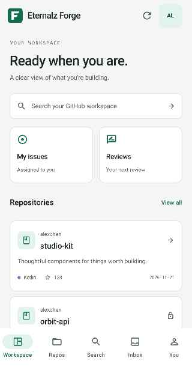

# Forge visual revision — 0.2.0

This revision replaces the original near-black/lime presentation with a **light-first,
neutral-and-evergreen** interface. Dark mode is an explicit option, not the initial
experience. A user-selected System or Dark preference remains respected.

## Root-cause correction

The original Android launch window was hard-coded near-black, while the disconnected
route did not paint a themed background. Light-mode text could therefore appear
on the dark window. `ForgeTheme` now always paints an opaque full-screen Surface;
the launch window is light and system-bar icon appearance follows the selected theme.
This fixes the underlying rendering mismatch, not just the accent color.

## Visual decisions

- Canvas: `#F5F6F3`; actual content surfaces: `#FFFFFF`.
- Primary text: `#1B2721`; supporting text: `#56665D`.
- Evergreen primary: `#146B50`, with `#E2F3EB` pale selection surfaces.
- Separators: `#DCE3DC`. No gradients, black hero panels or acid-green blocks.
- Sans-serif hierarchy with compact monospace metadata, not monospace body copy.
- Repository cards: 12dp corners, 1dp boundaries, readable descriptions and metadata.
- Home: compact search entry, two useful issue/review shortcuts, actual repositories,
  local drafts and real activity. No invented statistics or giant marketing headline.
- White bottom navigation with restrained selected state; compact single-line brand.
- Sign-in: concise introduction, a bounded white connection panel, narrow tablet
  measure, visible theme toggle, and fine-grained-token connection as the default.
  OAuth device-flow configuration remains under the explicit advanced path.
- Dark mode: softened charcoal surfaces, independently specified text/container colors.

## Visual regression tests

`DesignScreenshotTest` renders the actual Compose sign-in and workspace components
on an Android emulator in both light and dark. Workspace data is explicitly a
**test-only fixture**, not a fake connected account or production demo mode.

The sign-in test checks that the top-left background is actually light. Screenshot
artifacts include full-resolution PNGs and small JPEG previews. The workflow also
runs the typed destructive-confirmation and Keystore/account-isolation device tests.

Device testing and authenticated integration testing are separate. A passing fixture
screenshot test does not establish that all live GitHub account workflows work.

## Verified emulator captures

All five Android UI/security tests passed in
[CI run 44905175855](https://github.com/WaquarShaikh5555/eternalz-forge/actions/runs/44905175855)
on a Pixel 4 / Android 11 (API 30) emulator. These are actual Compose renders with
**synthetic test data**, not AI-generated pictures or screenshots of a web replica.
The JPEG previews are deliberately small; the `native-design-and-device-tests`
artifact contains full-resolution PNGs and device test reports.

- [Workspace — light](screenshots/workspace-light.jpg)
- [Sign-in — light](screenshots/sign-in-light.jpg)
- [Workspace — optional dark](screenshots/workspace-dark.jpg)

Core light-theme text contrasts are checked against the actual Kotlin palette:
14.25:1 primary text/canvas, 6.08:1 supporting text/white, 6.46:1 white/primary
button, and 8.49:1 primary-container text/background.

### Emulator tooling review

The additional CI tool is ReactiveCircus/android-emulator-runner v2.38.0,
pinned to `a421e43855164a8197daf9d8d40fe71c6996bb0d` (Apache-2.0).
Its metadata and SDK/emulator/shell execution sources were reviewed before use.
It downloads official Android SDK/system-image packages and accepts SDK licenses
on an ephemeral runner, uses KVM, and executes our fixed test script. No untrusted
repository/user input is interpolated into action configuration. The job has only
read access to repository contents and no production credentials. It does not
install an emulator in this restricted sandbox.

## 0.3.0 sign-in revision

The sign-in panel now starts with **Continue with GitHub**, not a personal-token
field. Private repositories and editing Actions workflow files are explicit scope
opt-ins. The manual token path is labeled Advanced, and the app owner configures
the public client ID at build time instead of making each user supply one.

The updated [sign-in capture](screenshots/sign-in-light.jpg) was inspected from
[CI run 44910837997](https://github.com/WaquarShaikh5555/eternalz-forge/actions/runs/44910837997).
All six emulator UI/security tests passed. Owner registration and live OAuth
approval are separate from these fixture/UI tests; see [GitHub setup](github-sign-in.md).

## 0.3.3 decluttering

The default workspace now emphasizes a compact repository list, a search entry,
and two text shortcuts. Oversized shortcut cards and marketing copy are removed;
activity, pins and recents are behind an explicit expansion. Sign-in uses a single
heading and optional permissions are collapsed by default (selected permissions
remain summarized). Repository navigation prioritizes Code, Issues and Pull
requests; less frequent destinations are in More. Repository deletion confirmations
show the full owner/name and a copy action without auto-confirming destruction.

New screenshots and CI results for this revision are pending; prior captures above
are historical rather than proof of this revision.
